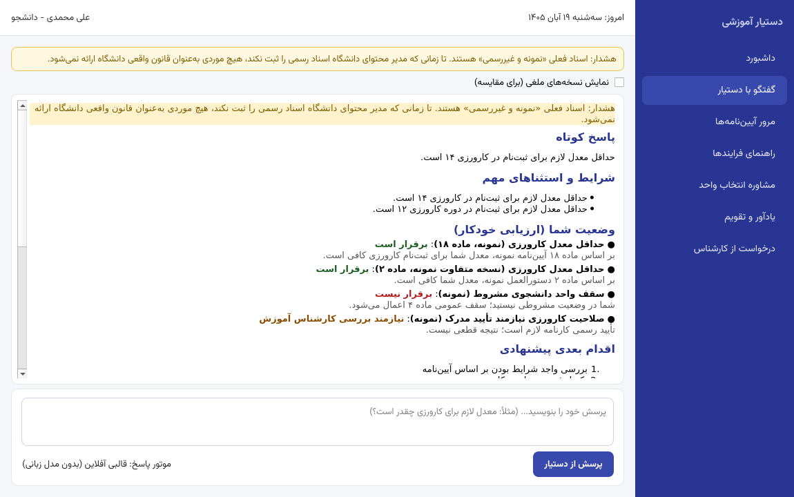

# دستیار آموزشی و آیین‌نامه‌ای دانشجو۳۶۰

نسخه دسکتاپ (اولیه) زیرسیستم «دستیار آموزشی و آیین‌نامه‌ای» از سامانه دانشجو۳۶۰ — به زبان فارسی، راست‌به‌چپ، آفلاین و مبتنی بر سند.

> **هشدار مهم:** تمام اسناد و قواعد همراه این نسخه «نمونه و غیررسمی» هستند. تا زمانی که مدیر محتوای دانشگاه اسناد رسمی را ثبت و منتشر نکند، این سامانه هیچ موردی را به‌عنوان قانون واقعی دانشگاه ارائه نمی‌کند و همه پاسخ‌ها با برچسب هشدار همراه است.



## اصل محصول

**اول منبع معتبر، بعد ارزیابی شرایط، در پایان پاسخ ساده و اقدام پیشنهادی.**

هر پاسخ سه لایه دارد که از هم تفکیک می‌شوند:

1. **متن رسمی سند** (عیناً، با ارجاع به سند/نسخه/ماده/صفحه)
2. **توضیح ساده** (مدل زبانی اختیاری یا موتور قالبی آفلاین)
3. **وضعیت شخصی دانشجو** (موتور قواعد قطعی — مستقل از هوش مصنوعی) و **اقدام بعدی پیشنهادی**

به‌علاوه بخش «موارد نیازمند تأیید کارشناس آموزش» همیشه جدا نمایش داده می‌شود.

## امکانات

- **گفتگوی مستند با دستیار** — پاسخ فقط بر اساس اسناد منتشرشده؛ ارجاع ساختگی حذف می‌شود؛ سند ملغی هرگز به‌عنوان قانون جاری نمایش داده نمی‌شود.
- **پایگاه دانش آیین‌نامه‌ها** — ثبت سند متنی/PDF/Word/لینک، نسخه‌بندی (پیش‌نویس ← در حال بررسی ← تأییدشده ← منتشرشده ← ملغی)، محدوده اعمال (مقطع/رشته/سال ورود)، بازه اعتبار تاریخ، تکه‌بندی بر اساس ماده و تبصره.
- **موتور قواعد قطعی** — ارزیابی چهارحالته (برقرار / برقرار نیست / اطلاعات ناکافی / نیازمند بررسی کارشناس)؛ قاعده فقط با منبعِ منتشرشده قابل تأیید است؛ فعال‌سازی هر قاعده نیازمند تأیید انسانی است.
- **راهنمای فرایندهای اداری** — مراحل، مدارک لازم و سامانه مقصد؛ این دستیار هرگز «ثبت موفق» اعلام نمی‌کند.
- **مشاوره انتخاب واحد** — تحلیل پیش‌نیاز، پیشنهاد دروس و بررسی فارغ‌التحصیلی بر اساس داده ثبت‌شده (جایگزین سامانه آموزشی نیست).
- **یادآور و تقویم جلالی** — تاریخ شمسی، اعلام رویدادهای نزدیک، ضدتکرار یادآور، و اصلاح‌پذیری تقویم (با هر اصلاح، نسخه رویداد عوض و یادآور دوباره اعلام می‌شود).
- **درخواست از کارشناس (تیکت)** — چرخه وضعیت: ثبت‌شده ← در حال بررسی ← نیاز به اطلاعات ← پاسخ داده شده ← بسته.
- **نقش‌ها و مجوزها در بک‌اند** — دانشجو، کارشناس آموزش، مدیر محتوای آیین‌نامه، تأییدکننده، مدیر سیستم؛ جداسازی کامل داده بین دانشگاه‌ها.
- **امنیت هوش مصنوعی** — محافظت از تزریق دستور (متن سند فقط «داده» است)، پرچم‌گذاری احتمال خطای OCR (به‌ویژه ارقام)، محدودسازی نرخ پرسش، حداقل‌سازی داده ارسالی به مدل.
- **مدل زبانی اختیاری** — اگر سرویس سازگار با OpenAI در تنظیمات پیکربندی شود استفاده می‌شود؛ در غیر این صورت موتور قالبی آفلاین پاسخ می‌دهد. ارجاع‌های مدل پس از دریافت اعتبارسنجی می‌شوند.

## اجرای سریع (از سورس)

```bash
pip install -r requirements.txt
python run.py
```

در اولین اجرا، دیتابیس ساخته و داده نمونه (با برچسب غیررسمی) ایجاد می‌شود.

حساب‌های نمایشی (رمز همه: `Name@123`):

| کاربر | نقش |
|---|---|
| `admin` | مدیر سیستم |
| `expert` | کارشناس آموزش |
| `content` | مدیر محتوای آیین‌نامه |
| `approver` | تأییدکننده |
| `student` | دانشجو |
| `student2` | دانشجو با سال ورود نامشخص (برای تست سناریو ۳) |

## نسخه پرتابل ویندوز (بدون نیاز به نصب پایتون)

از صفحه [Releases](https://github.com/hjalilvand2004-coder/DastyarAmoozeshi/releases) فایل
`DastyarAmoozeshi-Portable-Windows-*.zip` را دانلود کنید، باز کنید و `RUN-DastyarAmoozeshi.bat` را اجرا کنید.
جزئیات: [docs/07-portable.md](docs/07-portable.md)

## تست‌ها

```bash
pip install -r requirements-dev.txt
python -m pytest tests/ -q
```

۴۱ تست شامل **هشت سناریوی پذیرش الزامی** (بند ۱۸ مشخصات): سند ملغی، مغایرت اسناد، سال ورود نامشخص، خطای OCR، ارجاع بی‌ربط، اصلاح تقویم، دسترسی غیرمجاز، و دستور مخرب داخل سند. جزئیات: [docs/08-tests.md](docs/08-tests.md)

## ساختار پروژه

```
app/                 کد اصلی
  core-سرویس‌ها     db, jalali, security, search, ruleengine, llm, answers, services, seed
  ui/                رابط گرافیکی PyQt6 (۱۰ صفحه، RTL)
docs/                مستندات (نیازمندی، معماری، مدل داده، قرارداد API، ...)
tests/               تست‌های واحد، امنیت و پذیرش
scripts/             ساخت نسخه پرتابل و انتشار ریلیز
run.py               نقطه اجرا
```

## مستندات

1. [نیازمندی‌ها و فرض‌های طراحی](docs/01-requirements.md)
2. [معماری](docs/02-architecture.md)
3. [مدل داده](docs/03-data-model.md)
4. [قرارداد API برای یکپارچه‌سازی آینده](docs/04-api-contract.md)
5. [جریان پاسخ‌دهی مستند](docs/05-answer-flow.md)
6. [راهنمای نصب و اجرا](docs/06-install.md)
7. [نسخه پرتابل ویندوز](docs/07-portable.md)
8. [تست‌ها و سناریوهای پذیرش](docs/08-tests.md)
9. [محدودیت‌ها و موارد ناتمام](docs/09-limitations.md)

## صفحه‌ها (۱۰ صفحه)

داشبورد، گفتگو با دستیار، مرور آیین‌نامه‌ها، راهنمای فرایندها، مشاوره انتخاب واحد، یادآور و تقویم، درخواست از کارشناس، مدیریت اسناد، مدیریت قواعد، مدیریت کاربران و تنظیمات.

## محدودیت‌های مهم این نسخه

- OCR خودکار برای PDFهای اسکن‌شده پیاده‌سازی نشده است (ثبت متن OCR‌شده دستی یا فایل متنی پشتیبانی می‌شود و در صورت تشخیص خطا، هشدار داده می‌شود).
- یکپارچه‌سازی با Keycloak/SSO و سامانه‌های واقعی دانشگاه (آموزش، انتخاب واحد، تقویم رسمی) در نسخه بعدی است؛ قرارداد API آن طراحی شده است (docs/04).
- تحلیل سختی دروس (اولویت ۲) به فاز ۲ موکول شده است.
- بدون کلید API، موتور پاسخ «قالبی آفلاین» است (نه مدل مولد)؛ این موضوع صادقانه در رابط کاربری نمایش داده می‌شود.

فهرست کامل: [docs/09-limitations.md](docs/09-limitations.md)

## مجوز

MIT — فونت وزیرمتن تحت مجوز OFL (پوشه `app/resources/fonts`).
